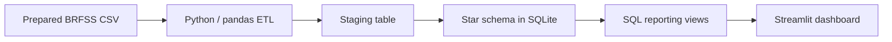

# Med Warehouse | Health Data Engineering & Analytics

**From public health survey data to a structured warehouse and an interactive analytics dashboard.**

Med Warehouse is a data engineering portfolio project built with **Python, pandas, SQLite, SQL and Streamlit**. It organises BRFSS health and lifestyle survey records into a star schema, exposes reusable SQL reporting views, and makes yearly trends and demographic comparisons accessible through a dashboard.

The project demonstrates the analytical layer that complements a machine learning workflow: preparing data for consistent reporting, defining metrics in SQL, and presenting results with their interpretation limits.

[Polska wersja opisu](README.pl.md)

## What the project delivers

- **An ETL pipeline** that loads a prepared CSV, standardises coded fields, derives measures and builds a local SQLite warehouse.
- **A star schema** with one fact table and eight dimensions covering time, geography and respondent characteristics.
- **Three reporting views** for annual KPIs, comparisons across US states, and age/sex breakdowns.
- **An interactive Streamlit dashboard** with year selection, summary metrics, a trend chart, a top-15 state comparison and demographic tables.
- **A reproducible sample workflow** using the 5,000-row dataset included in this repository.

## Questions the dashboard helps explore

- How does the share of respondents meeting the project's target definition vary by year?
- Which states have the highest target rate within the selected records and years?
- How does that rate differ across age groups and sexes?

The dashboard aggregates an existing survey-derived flag. It does not train a model or generate individual risk predictions.

## Architecture



Raw BRFSS XPT files can be processed separately with the preprocessing scripts in the repository root. The quick start below uses the included CSV sample, so no raw-data download is needed.

## Technology stack

| Component | Technology | Role |
| --- | --- | --- |
| Transformation | Python, pandas | Type conversion, staging preparation and dimension/fact construction |
| Storage | SQLite | Local warehouse in a single generated file |
| Reporting | SQL | Aggregations and shared metric definitions |
| Interface | Streamlit | Interactive filtering, charts, metrics and tables |

## Quick start

Use **Python 3.10 or later**. Run the following commands from the repository root unless stated otherwise.

### 1. Clone and install dependencies

```bash
git clone https://github.com/raaddi/med-warehouse.git
cd med-warehouse
python -m venv .venv
```

Activate the environment:

```powershell
# Windows PowerShell
.\.venv\Scripts\Activate.ps1
```

```bash
# macOS / Linux
source .venv/bin/activate
```

```bash
python -m pip install -r dw_project/requirements.txt
```

### 2. Prepare the included sample

The committed sample uses a semicolon delimiter. The ETL expects a comma-delimited file named `data_processed/model_data_preprocessed.csv`, which is generated locally and excluded from Git.

```bash
python -c "import pandas as pd; pd.read_csv('data_processed/brfss_after_preprocessing_sample.csv', sep=';').to_csv('data_processed/model_data_preprocessed.csv', index=False)"
```

This converts the input format; it does not change the sample's values.

### 3. Build the warehouse

```bash
python dw_project/etl/build_warehouse.py
```

Output: `dw_project/data/brfss_dw.sqlite`.

The pipeline performs a **full rebuild** of the warehouse tables and reporting views on each run. It does not append new records incrementally.

### 4. Launch the dashboard

```bash
python -m streamlit run dw_project/dashboard/app.py
```

Open the local address printed by Streamlit. The current dashboard interface is in Polish; the underlying table and view names are in English.

## Data model

**Grain:** one input survey record per row in `fact_health_survey`. The pipeline assigns a local `respondent_id`; this is not a stable person identifier across survey years.

| Layer | Tables / views | Purpose |
| --- | --- | --- |
| Staging | `stg_brfss_model` | Standardised source fields and derived measures |
| Fact | `fact_health_survey` | Target flag, health measures, survey codes and dimension keys |
| Dimensions | `dim_year`, `dim_state`, `dim_age_group`, `dim_sex` | Year, state, age group and sex |
| Dimensions | `dim_education`, `dim_income`, `dim_employment`, `dim_urban` | Education, income, employment and urban/rural context |

Measures include a respondent count of `1` per record, BMI derived from `_BMI5 / 100`, physically unhealthy days, and the number of children. Some additional survey attributes remain coded fields in the fact table.

`create_schema.sql` defines the intended schema, keys and indexes. The current loader uses pandas `to_sql(..., if_exists="replace")`, so the resulting tables do not retain the constraints and indexes declared in that SQL file.

## Reporting views and metrics

| View | Breakdown | Available metrics |
| --- | --- | --- |
| `vw_kpi_by_year` | Year | Respondents, target-positive count, target rate, average BMI and physically unhealthy days |
| `vw_target_by_state` | Year and state | Respondents, target-positive count and target rate |
| `vw_target_by_age_sex` | Year, age group and sex | Respondents, target-positive count and target rate |

The dashboard displays counts and target rates; the annual SQL view also exposes the two average health measures for further queries.

```sql
SELECT year, respondents, target_positive, target_rate_pct
FROM vw_kpi_by_year
ORDER BY year;
```

The target rate is calculated as:

```text
100 × SUM(target_flag) / SUM(respondent_count)
```

Across multiple selected years, the dashboard recomputes the rate from summed counts rather than averaging annual percentages.

### What does `target` mean?

The preprocessing code defines `target = 1` when **both** `mental_low = 1` and `chronic_any = 1`. The main mental-health branch checks for at least 14 reported days of poor mental health; the chronic-condition flag checks selected available survey variables for a coded value of `1`. A fallback branch uses `_MENT14D` when `MENTHLTH` is unavailable.

This is a project-specific indicator derived from self-reported survey answers. It is not a clinical diagnosis or a model prediction. The exact variable coding and missing-value handling should be checked against each year's BRFSS documentation before interpreting the indicator substantively.

## Included sample: verified ETL output

The committed preprocessed sample contains **5,000 records from 2022–2024**. Building the warehouse from that sample produces:

| Year | Respondents | Target-positive | Target rate |
| --- | ---: | ---: | ---: |
| 2022 | 1,656 | 116 | 7.00% |
| 2023 | 1,719 | 107 | 6.22% |
| 2024 | 1,625 | 132 | 8.12% |

These are descriptive results for the included sample, not population estimates.

## Using a different prepared dataset

Place a comma-delimited CSV at `data_processed/model_data_preprocessed.csv`. The current ETL requires these columns:

```text
_AGEG5YR, _SEX, EDUCA, INCOME3, EMPLOY1, _STATE, _URBSTAT,
CHECKUP1, GENHLTH, RENTHOM1, MEDCOST1, PERSDOC3,
year, target, _BMI5, PHYSHLTH, CHILDREN
```

`target` should be binary (`0` or `1`). Coded categorical values are converted to integers, with missing or non-numeric entries mapped to `0`. Measures are converted separately to numeric values. The source validation explicitly checks the coded columns; `_BMI5`, `PHYSHLTH` and `CHILDREN` must also be present for staging preparation.

The root preprocessing scripts are development utilities: they contain local input paths that must be adapted. `preprocessing_colab_fixed.py` returns a prepared DataFrame through `run_pipeline()`, while `preprocessing_extracted.py` exports comparison samples. Neither script automatically creates the warehouse input file at the expected path. When preparing a larger dataset, export a DataFrame with the required columns using `to_csv(..., index=False)`.

## Repository structure

```text
med-warehouse/
├── README.md
├── README.pl.md
├── data_processed/
│   ├── brfss_before_preprocessing_sample.csv
│   ├── brfss_after_preprocessing_sample.csv
│   └── common_cols.csv
├── dw_project/
│   ├── dashboard/app.py
│   ├── etl/build_warehouse.py
│   ├── sql/create_schema.sql
│   ├── sql/create_marts.sql
│   ├── requirements.txt
│   └── run_etl.ps1
├── preprocessing_colab_fixed.py
└── preprocessing_extracted.py
```

The warehouse input CSV and SQLite database are generated locally and are not committed.

## Scope and interpretation limits

- **Portfolio prototype:** local ETL and reporting, with no incremental loading or scheduled orchestration.
- **Unweighted sample:** calculations do not apply BRFSS survey weights or survey-design adjustments. The raw-data utilities load the first 50,000 records per year by default; the included sample is not documented as nationally representative.
- **Preprocessing assumptions:** the utilities use a generic list of missing-value codes across numeric features. Variable-specific recoding needs review, since the same numeric value may be valid for one variable and a missing code for another.
- **Descriptive comparisons:** state rankings have no minimum group-size threshold or uncertainty estimates. Differences should not be read as causal findings or clinical risk scores.

## Data source

The project uses the **Behavioral Risk Factor Surveillance System (BRFSS)**, a public health survey programme coordinated by the US Centers for Disease Control and Prevention.

- [CDC BRFSS overview](https://www.cdc.gov/brfss/)
- [Annual survey data and documentation](https://www.cdc.gov/brfss/annual_data/annual_data.htm)

Use the relevant annual codebooks when extending the preprocessing or interpreting survey variables.
