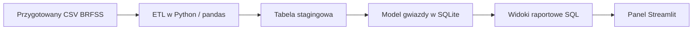

# Med Warehouse | Inżynieria danych i analityka zdrowotna

**Od danych ankietowych do uporządkowanej hurtowni i interaktywnego panelu analitycznego.**

Med Warehouse to projekt portfolio z obszaru inżynierii danych, zbudowany w **Pythonie z wykorzystaniem pandas, SQLite, SQL i Streamlit**. Porządkuje dane ankietowe BRFSS w modelu gwiazdy, udostępnia widoki raportowe SQL i pozwala analizować trendy roczne oraz różnice między grupami respondentów.

Projekt pokazuje warstwę analityczną uzupełniającą proces uczenia maszynowego: przygotowanie danych do raportowania, spójne definicje wskaźników oraz prezentację wyników wraz z ograniczeniami ich interpretacji.

[English version](README.md)

## Co realizuje projekt

- **Proces ETL:** odczyt przygotowanego pliku CSV, standaryzacja kodów, obliczanie miar i budowa lokalnej hurtowni SQLite.
- **Model gwiazdy:** tabela faktów i osiem wymiarów opisujących czas, geografię oraz cechy respondentów.
- **Trzy widoki raportowe:** roczne KPI, porównania stanów USA oraz przekroje według wieku i płci.
- **Panel Streamlit:** wybór lat, wskaźniki zbiorcze, wykres trendu, porównanie 15 stanów o najwyższym wskaźniku i tabele demograficzne.
- **Odtwarzalny przykład:** uruchomienie na próbce 5000 rekordów dołączonej do repozytorium.

## Na jakie pytania pomaga odpowiedzieć

- Jak zmienia się między latami udział respondentów spełniających przyjętą definicję `target`?
- Które stany mają najwyższy wskaźnik w analizowanych rekordach i wybranych latach?
- Jak wskaźnik różni się między grupami wieku i płciami?

Panel agreguje istniejącą flagę wyznaczoną na podstawie odpowiedzi ankietowych. Nie trenuje modelu ML i nie generuje indywidualnych prognoz ryzyka.

## Architektura



Surowe pliki BRFSS w formacie XPT można przetwarzać osobno przy użyciu skryptów w katalogu głównym. Poniższa instrukcja korzysta z dołączonej próbki CSV, więc nie wymaga pobierania surowych danych.

## Technologie

| Warstwa | Technologie | Zastosowanie |
| --- | --- | --- |
| Transformacja | Python, pandas | Konwersja typów, staging, budowa wymiarów i faktów |
| Przechowywanie | SQLite | Lokalna hurtownia w jednym pliku |
| Raportowanie | SQL | Agregacje i wspólne definicje wskaźników |
| Interfejs | Streamlit | Filtrowanie, wykresy, wskaźniki i tabele |

## Szybkie uruchomienie

Zalecany jest **Python 3.10 lub nowszy**. Polecenia wykonuj z katalogu głównego repozytorium.

### 1. Pobierz projekt i zainstaluj zależności

```bash
git clone https://github.com/raaddi/med-warehouse.git
cd med-warehouse
python -m venv .venv
```

Aktywuj środowisko:

```powershell
# Windows PowerShell
.\.venv\Scripts\Activate.ps1
```

```bash
# macOS / Linux
source .venv/bin/activate
```

```bash
python -m pip install -r dw_project/requirements.txt
```

### 2. Przygotuj dołączoną próbkę

Próbka w repozytorium używa średnika jako separatora. ETL oczekuje pliku rozdzielanego przecinkami pod nazwą `data_processed/model_data_preprocessed.csv`. Plik ten jest generowany lokalnie i pomijany przez Git.

```bash
python -c "import pandas as pd; pd.read_csv('data_processed/brfss_after_preprocessing_sample.csv', sep=';').to_csv('data_processed/model_data_preprocessed.csv', index=False)"
```

Polecenie zmienia format zapisu, zachowując wartości w próbce.

### 3. Zbuduj hurtownię

```bash
python dw_project/etl/build_warehouse.py
```

Wynik: `dw_project/data/brfss_dw.sqlite`.

Każde uruchomienie **przebudowuje tabele i widoki**. Proces nie dopisuje danych przyrostowo.

### 4. Uruchom panel

```bash
python -m streamlit run dw_project/dashboard/app.py
```

Otwórz adres lokalny wskazany przez Streamlit. Interfejs panelu jest w języku polskim; nazwy tabel i widoków są angielskie.

## Model danych

**Ziarnistość:** jeden wejściowy rekord ankietowy odpowiada jednemu wierszowi w `fact_health_survey`. ETL nadaje lokalny `respondent_id`, który nie identyfikuje tej samej osoby pomiędzy latami.

| Warstwa | Tabele / widoki | Rola |
| --- | --- | --- |
| Staging | `stg_brfss_model` | Ujednolicone pola źródłowe i obliczone miary |
| Fakty | `fact_health_survey` | Flaga target, miary zdrowotne, kody ankietowe i klucze wymiarów |
| Wymiary | `dim_year`, `dim_state`, `dim_age_group`, `dim_sex` | Rok, stan, grupa wieku i płeć |
| Wymiary | `dim_education`, `dim_income`, `dim_employment`, `dim_urban` | Wykształcenie, dochód, zatrudnienie i obszar miejski/wiejski |

Miary obejmują licznik respondentów równy `1` dla każdego rekordu, BMI obliczane jako `_BMI5 / 100`, liczbę dni złego zdrowia fizycznego i liczbę dzieci. Część dodatkowych odpowiedzi pozostaje kodami w tabeli faktów.

`create_schema.sql` opisuje docelowy schemat, klucze i indeksy. Obecny loader wykorzystuje jednak pandas `to_sql(..., if_exists="replace")`, więc utworzone w ten sposób tabele nie zachowują ograniczeń i indeksów zadeklarowanych w pliku SQL.

## Widoki raportowe i wskaźniki

| Widok | Przekrój | Dostępne miary |
| --- | --- | --- |
| `vw_kpi_by_year` | Rok | Liczba respondentów, liczba target-positive, target rate, średnie BMI i dni złego zdrowia fizycznego |
| `vw_target_by_state` | Rok i stan | Liczba respondentów, liczba target-positive i target rate |
| `vw_target_by_age_sex` | Rok, grupa wieku i płeć | Liczba respondentów, liczba target-positive i target rate |

Panel prezentuje liczebności i wskaźnik target. Roczny widok SQL udostępnia również średnie miary zdrowotne do dalszych zapytań.

```sql
SELECT year, respondents, target_positive, target_rate_pct
FROM vw_kpi_by_year
ORDER BY year;
```

Wskaźnik jest obliczany jako:

```text
100 × SUM(target_flag) / SUM(respondent_count)
```

Po wybraniu kilku lat panel przelicza wskaźnik z sum liczebności, zamiast uśredniać roczne wartości procentowe.

### Co oznacza `target`?

Preprocessing ustawia `target = 1`, gdy **jednocześnie** `mental_low = 1` i `chronic_any = 1`. Główna ścieżka dla zdrowia psychicznego sprawdza co najmniej 14 zgłoszonych dni złego samopoczucia psychicznego. Flaga chorób przewlekłych sprawdza wartość kodową `1` w wybranych dostępnych zmiennych. Gdy brakuje `MENTHLTH`, kod korzysta z alternatywnej ścieżki opartej na `_MENT14D`.

To wskaźnik zdefiniowany na potrzeby projektu, obliczany na podstawie samoopisu respondentów. Nie jest diagnozą ani predykcją modelu. Przed interpretacją merytoryczną należy zweryfikować kodowanie zmiennych i obsługę braków danych z dokumentacją BRFSS dla danego roku.

## Dołączona próbka: zweryfikowany wynik ETL

Próbka po preprocessingu zawiera **5000 rekordów z lat 2022–2024**. Po zbudowaniu hurtowni uzyskano:

| Rok | Respondenci | Target-positive | Target rate |
| --- | ---: | ---: | ---: |
| 2022 | 1656 | 116 | 7,00% |
| 2023 | 1719 | 107 | 6,22% |
| 2024 | 1625 | 132 | 8,12% |

Są to wyniki opisowe dla dołączonej próbki, a nie oszacowania dla całej populacji.

## Własny przygotowany zbiór danych

Zapisz CSV rozdzielany przecinkami jako `data_processed/model_data_preprocessed.csv`. Obecny ETL wymaga kolumn:

```text
_AGEG5YR, _SEX, EDUCA, INCOME3, EMPLOY1, _STATE, _URBSTAT,
CHECKUP1, GENHLTH, RENTHOM1, MEDCOST1, PERSDOC3,
year, target, _BMI5, PHYSHLTH, CHILDREN
```

`target` powinien przyjmować wartości `0` albo `1`. Pola kodowe są konwertowane do liczb całkowitych, a brakujące i nienumeryczne wpisy otrzymują wartość `0`. Miary są przetwarzane osobno. Walidacja wejścia sprawdza wprost pola kodowe; kolumny `_BMI5`, `PHYSHLTH` i `CHILDREN` także muszą istnieć, aby przygotowanie stagingu się powiodło.

Skrypty preprocessingu w katalogu głównym są narzędziami roboczymi z lokalnymi ścieżkami wymagającymi dostosowania. `preprocessing_colab_fixed.py` zwraca przygotowany DataFrame przez `run_pipeline()`, a `preprocessing_extracted.py` eksportuje próbki porównawcze. Żaden z tych skryptów nie tworzy automatycznie oczekiwanego pliku wejściowego hurtowni. Przy większym zbiorze należy zapisać DataFrame z wymaganymi kolumnami za pomocą `to_csv(..., index=False)`.

## Struktura repozytorium

```text
med-warehouse/
├── README.md
├── README.pl.md
├── data_processed/
│   ├── brfss_before_preprocessing_sample.csv
│   ├── brfss_after_preprocessing_sample.csv
│   └── common_cols.csv
├── dw_project/
│   ├── dashboard/app.py
│   ├── etl/build_warehouse.py
│   ├── sql/create_schema.sql
│   ├── sql/create_marts.sql
│   ├── requirements.txt
│   └── run_etl.ps1
├── preprocessing_colab_fixed.py
└── preprocessing_extracted.py
```

Wejściowy CSV hurtowni i baza SQLite powstają lokalnie i nie są dodawane do repozytorium.

## Zakres i ograniczenia interpretacji

- **Prototyp portfolio:** lokalny ETL i raportowanie, bez ładowania przyrostowego i harmonogramu wykonania.
- **Próbka bez wag:** obliczenia nie uwzględniają wag BRFSS ani schematu badania. Skrypty surowych danych domyślnie odczytują pierwsze 50 000 rekordów z każdego roku; dołączona próbka nie ma udokumentowanej reprezentatywności krajowej.
- **Założenia preprocessingu:** ogólna lista kodów braków danych jest stosowana do różnych pól numerycznych. Rekodowanie wymaga weryfikacji dla każdej zmiennej, ponieważ ta sama liczba może oznaczać prawidłową odpowiedź lub brak danych.
- **Porównania opisowe:** ranking stanów nie stosuje minimalnej liczebności grup ani miar niepewności. Wyników nie należy traktować jako zależności przyczynowych ani klinicznej oceny ryzyka.

## Źródło danych

Projekt korzysta z **Behavioral Risk Factor Surveillance System (BRFSS)**, programu badań ankietowych koordynowanego przez amerykańskie Centers for Disease Control and Prevention.

- [Informacje o BRFSS](https://www.cdc.gov/brfss/)
- [Dane roczne i dokumentacja](https://www.cdc.gov/brfss/annual_data/annual_data.htm)

Przy rozszerzaniu preprocessingu i interpretacji zmiennych należy korzystać z dokumentacji właściwej dla danego roku.
