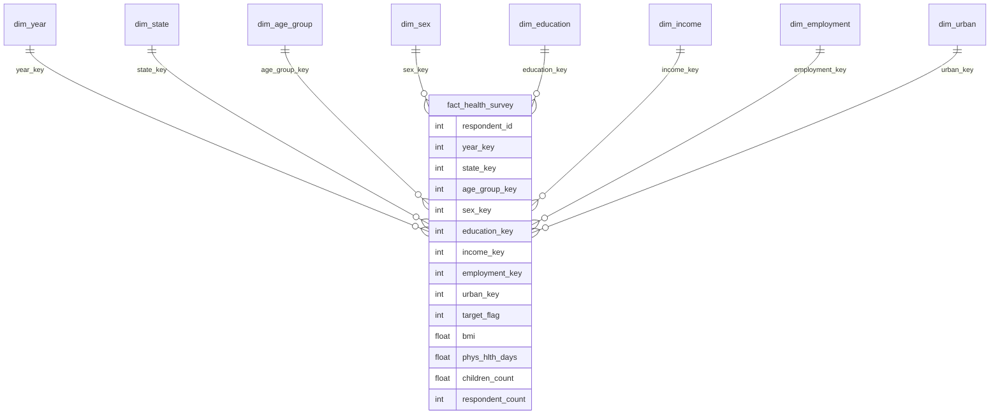
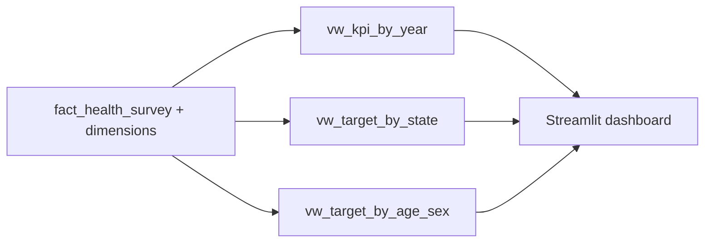

# Logical data model

[English overview](../README.md) · [Opis po polsku](../README.pl.md)

The warehouse uses a star schema: one survey-record fact table connects to eight dimensions through surrogate keys. The diagram shows the logical joins used by the ETL and reporting layer; it does not imply that SQLite currently enforces foreign-key constraints.

Hurtownia wykorzystuje model gwiazdy: tabela faktów na poziomie rekordu ankietowego łączy się z ośmioma wymiarami przez klucze zastępcze. Diagram przedstawia logiczne relacje używane w ETL i raportach, a nie ograniczenia wymuszane obecnie przez SQLite.

## Dimension attributes

Each dimension contains a generated integer key, the source survey code and a display label. The exact columns are:

| Dimension | Key | Source code | Display label |
| --- | --- | --- | --- |
| `dim_year` | `year_key` | `year_code` | `year_label` |
| `dim_state` | `state_key` | `state_code` | `state_label` |
| `dim_age_group` | `age_group_key` | `age_group_code` | `age_group_label` |
| `dim_sex` | `sex_key` | `sex_code` | `sex_label` |
| `dim_education` | `education_key` | `education_code` | `education_label` |
| `dim_income` | `income_key` | `income_code` | `income_label` |
| `dim_employment` | `employment_key` | `employment_code` | `employment_label` |
| `dim_urban` | `urban_key` | `urban_code` | `urban_label` |

Code `0` is added to every dimension as a fallback. The ETL assigns `Unknown` labels to coded demographic dimensions; year and state labels use the code converted to text.

## Fact-table grain and attributes

- One row represents one input survey record.
- `respondent_id` is generated during the ETL run; it is not a cross-year person identifier.
- `respondent_count = 1` provides the denominator for count-based reporting.
- `target_flag` is copied from the prepared dataset's binary `target` column.
- `bmi` is derived from `_BMI5 / 100`; `phys_hlth_days` and `children_count` are numeric measures.
- Additional coded attributes, omitted from the diagram for readability, are `checkup_code`, `genhlth_code`, `housing_code`, `medcost_code` and `persdoc_code`.

Dimension keys are regenerated on each full rebuild. They should not be treated as permanent identifiers outside the generated warehouse.

## Reporting layer

The reporting views aggregate survey records by year, state and age/sex. See the main README for metric definitions, sample results and interpretation limits.
